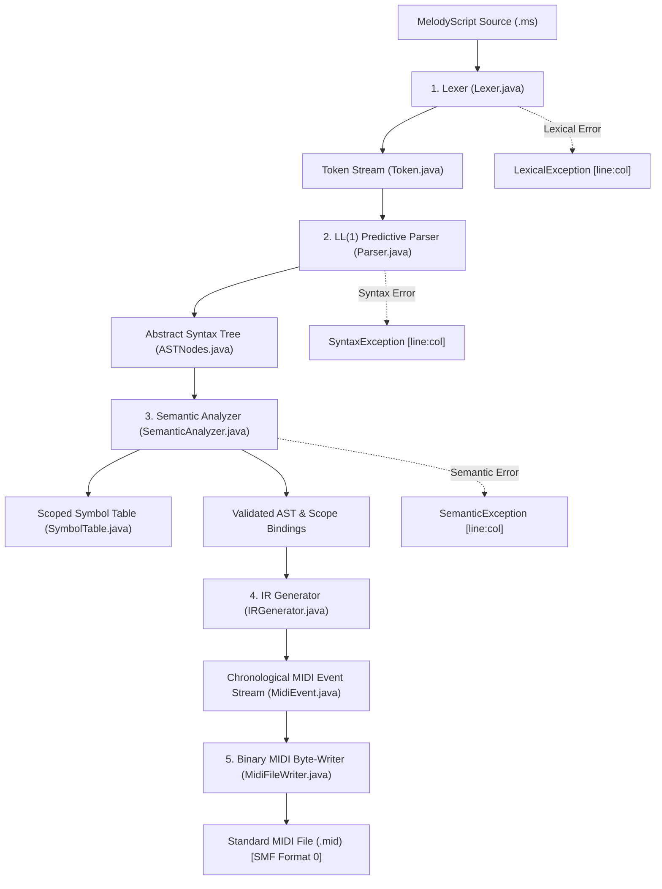

# MelodyScript Complete Compiler: Source-to-Binary MIDI

A pure Java (JDK 17+) domain-specific compiler for **MelodyScript**, producing fully compliant **Standard MIDI Files (SMF Format 0)** with **zero third-party dependencies**.

---

## 1. Complete Compiler Architecture



---

## 2. Binary MIDI File Structure (SMF Format 0)

1. **Header Chunk (`MThd`)** (14 bytes):
   - Offset `0..3`: `4D 54 68 64` (`"MThd"`)
   - Offset `4..7`: `00 00 00 06` (Header length: 6 bytes)
   - Offset `8..9`: `00 00` (Format 0: single track)
   - Offset `10..11`: `00 01` (1 Track)
   - Offset `12..13`: `01 E0` (Division: 480 PPQ)
2. **Track Chunk (`MTrk`)**:
   - Offset `14..17`: `4D 54 72 6B` (`"MTrk"`)
   - Offset `18..21`: 4-byte big-endian track payload length in bytes.
   - Offset `22..`: Events serialized with **Variable-Length Quantity (VLQ)** delta-times:
     - `TEMPO_META`: `[VLQ delta] 0xFF 0x51 0x03 [3-byte microseconds/quarter note]`
     - `PROGRAM_CHANGE`: `[VLQ delta] (0xC0 | ch) [programNumber]`
     - `NOTE_ON`: `[VLQ delta] (0x90 | ch) [pitch] [velocity: 100]`
     - `NOTE_OFF`: `[VLQ delta] (0x80 | ch) [pitch] [velocity: 0]`
     - `END_OF_TRACK`: `[VLQ delta] 0xFF 0x2F 0x00`

---

## 3. Project Components

| Stage | Class | Description |
| :--- | :--- | :--- |
| **CLI Driver** | [`Main.java`](file:///C:/Users/sanja/OneDrive/Documents/Compiler_Design/Final_Project/Main.java) | Command-line compiler orchestrating stages with `--ast`, `--ir`, and `--hex` flags. |
| **Backend** | [`MidiFileWriter.java`](file:///C:/Users/sanja/OneDrive/Documents/Compiler_Design/Final_Project/MidiFileWriter.java) | Binary MIDI byte serializer, bitwise VLQ encoder, and hex dump visualizer. |
| **IR** | [`IRGenerator.java`](file:///C:/Users/sanja/OneDrive/Documents/Compiler_Design/Final_Project/IRGenerator.java) | Linear timeline event flattener, phrase unroller, and loop expander. |
| **IR** | [`MidiEvent.java`](file:///C:/Users/sanja/OneDrive/Documents/Compiler_Design/Final_Project/MidiEvent.java) | Timeline event data structure with deterministic tie-break sorting. |
| **Semantics** | [`SemanticAnalyzer.java`](file:///C:/Users/sanja/OneDrive/Documents/Compiler_Design/Final_Project/SemanticAnalyzer.java) | Static validator for declaration-before-use, uniqueness, pitch bounds, tempo, and GM instruments. |
| **Semantics** | [`SymbolTable.java`](file:///C:/Users/sanja/OneDrive/Documents/Compiler_Design/Final_Project/SymbolTable.java) | Scoped symbol table and General MIDI Level 1 instrument mapping (0-127). |
| **Semantics** | [`SemanticException.java`](file:///C:/Users/sanja/OneDrive/Documents/Compiler_Design/Final_Project/SemanticException.java) | Semantic exception detailing rule number and offender. |
| **Parser** | [`Parser.java`](file:///C:/Users/sanja/OneDrive/Documents/Compiler_Design/Final_Project/Parser.java) | LL(1) predictive recursive-descent parser. |
| **Parser** | [`ASTNodes.java`](file:///C:/Users/sanja/OneDrive/Documents/Compiler_Design/Final_Project/ASTNodes.java) | AST node hierarchy (`ProgramNode`, `TempoNode`, `InstrumentNode`, etc.) with ASCII tree visualizer. |
| **Parser** | [`SyntaxException.java`](file:///C:/Users/sanja/OneDrive/Documents/Compiler_Design/Final_Project/SyntaxException.java) | Syntax exception detailing expected vs found tokens. |
| **Lexer** | [`Lexer.java`](file:///C:/Users/sanja/OneDrive/Documents/Compiler_Design/Final_Project/Lexer.java) | Character-by-character scanner and scientific MIDI pitch calculator. |
| **Lexer** | [`Token.java`](file:///C:/Users/sanja/OneDrive/Documents/Compiler_Design/Final_Project/Token.java) | Lexical token structure with coordinates, pitch values, and duration ticks. |
| **Lexer** | [`LexicalException.java`](file:///C:/Users/sanja/OneDrive/Documents/Compiler_Design/Final_Project/LexicalException.java) | Lexical exception with 1-based source coordinates. |
| **Testing** | [`CompilerEndToEndTest.java`](file:///C:/Users/sanja/OneDrive/Documents/Compiler_Design/Final_Project/CompilerEndToEndTest.java) | End-to-end integration test validating binary byte structure and `javax.sound.midi` loading. |

---

## 4. Compilation & Execution

```powershell
# Compile all source files
javac *.java

# Compile a MelodyScript program to binary MIDI (.mid)
java Main sample.ms sample.mid

# Compile with Full Diagnostic Dumps (AST, IR timeline, and Hexadecimal byte dump)
java Main sample.ms sample.mid --ast --ir --hex

# Run Individual Stage Drivers
java LexerDriver
java ParserDriver
java SemanticDriver
java IRDriver

# Run Complete Automated Test Suite (46 tests across 5 test suites)
java LexerTest
java ParserTest
java SemanticTest
java IRTest
java CompilerEndToEndTest
```
